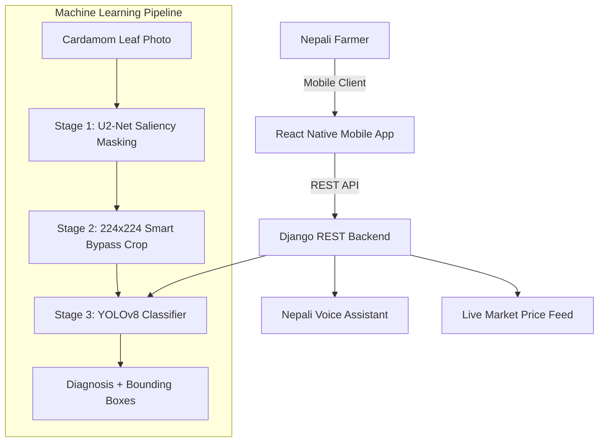

# 🌱 KrishiMitra: Cardamom Farming Assistant

**Smart AI-powered farming solutions for Nepali cardamom farmers**

## 🎬 Demo Video

https://github.com/user-attachments/assets/6e9438fa-49cf-407a-b568-c4dd3ed282d4

*Watch Krishimitra in action: Disease detection, voice queries in Nepali, and live market prices for cardamom farmers*

---

KrishiMitra provides smart agricultural tools for cardamom farmers in Nepal. The system detects leaf diseases, answers voice questions in Nepali, and displays live market prices.

## 1. System Overview

KrishiMitra connects three primary components:
1. **Mobile Application**: A React Native cross-platform client with English and Nepali language support.
2. **Backend API**: A Django REST service for inference, diagnosis persistence, and audio queries.
3. **Machine Learning Pipeline**: A two-stage computer vision workflow with U2-Net leaf segmentation and YOLOv8 pathology classification.



---

## 2. Machine Learning Pipeline

### Architecture
- **Stage 1 (Leaf Saliency)**: PyTorch U2-Net isolates the plant leaf from field backgrounds.
- **Stage 2 (Smart Bypass)**: If background contrast is already clean, the pipeline keeps original leaf texture.
- **Stage 3 (Pathology Classification)**: YOLOv8 classifies the cardamom leaf condition:
  - *Colletotrichum Leaf Blight*
  - *Phyllosticta Leaf Spot*
  - *Healthy Leaf*
- **Stage 4 (Lesion Localization)**: Botanical contour segmentation computes affected leaf percentage and draws localized bounding boxes with disease tags.

### Model Evaluation Results

The model underwent 5-Fold Stratified Cross-Validation on hardware with an NVIDIA GPU and CPU fallback.

| Evaluation Metric | 5-Fold Cross-Validation Result |
| :--- | :--- |
| **Mean Accuracy** | **96.42% ± 1.09%** |
| **Mean Macro F1-Score** | **95.54% ± 1.34%** |
| **Mean Precision** | **95.18% ± 1.56%** |
| **Mean Recall** | **96.00% ± 1.04%** |

#### Fold Accuracy Breakdown
- Fold 1: 94.47%
- Fold 2: 97.73%
- Fold 3: 96.72%
- Fold 4: 96.21%
- Fold 5: 96.96%

All fold reports and confusion matrices are in `ml_pipeline/reports/`.

---

## 3. Evaluation Integrity & Data Leakage Checks

Before release, we ran strict validation tests for underfitting, overfitting, and data leakage.

### Underfitting Verification
- Training loss decreases smoothly to ~0.05.
- Top-1 training accuracy exceeds 98%.
- The model does not underfit.

### Overfitting Verification
- Validation accuracy remains stable across all five folds (96.42% ± 1.09%).
- Validation loss does not diverge from training loss.
- The model generalizes well to test samples.

### Data Leakage Audit
- An audit of the raw dataset identified duplicate image files present across initial split directories (431 duplicates out of 2,156 files).
- We tested the model against strictly clean, non-duplicated test images:
  - **Clean Unseen Test Images**: **91.67%** accuracy (55/60).
  - **Overall Test Set**: **95.40%** accuracy (166/174).
- The high score on unseen clean images confirms robust model generalization.

---

## 4. Repository Structure

```text
krishimitra/
├── backend/                     # Django REST Framework backend
│   ├── api/                     # Core endpoints, models, serializers, views
│   │   ├── ml_models/           # Production model weights
│   │   └── services/            # YOLO detector and diagnosis engine
│   ├── krishimitra_backend/     # Django configuration and URL routes
│   └── manage.py                # Django CLI tool
├── ml_pipeline/                 # Computer vision pipeline
│   ├── configs/                 # Pipeline settings and device selectors
│   ├── models/                  # U2-Net model definition
│   ├── reports/                 # 5-fold CV reports and confusion matrix plots
│   ├── src/                     # Preprocessing, training, and evaluation scripts
│   ├── run_pipeline.py          # End-to-end pipeline runner
│   └── requirements.txt         # ML dependencies
├── mobile-app/                  # React Native and Expo client
│   ├── src/
│   │   ├── context/             # Language context for English and Nepali
│   │   ├── screens/             # Diagnosis, Voice, Market, and Home screens
│   │   └── services/            # API integration client
│   ├── App.js                   # Application root
│   └── package.json             # Mobile app dependencies
└── .gitignore                   # Git exclusion rules
```

---

## 5. Quick Start Instructions

### Prerequisites
- Python 3.10 to 3.12
- Node.js 18 or newer
- PyTorch with CUDA or CPU support

### Backend Setup

1. Open a terminal in the `backend/` directory:
   ```bash
   cd backend
   ```
2. Apply database migrations:
   ```bash
   python manage.py migrate
   ```
3. Start the development server:
   ```bash
   python manage.py runserver 127.0.0.1:8000
   ```
4. Check server health at `http://127.0.0.1:8000/api/health/`.

### Mobile Application Setup

1. Open a terminal in the `mobile-app/` directory:
   ```bash
   cd mobile-app
   ```
2. Install npm dependencies:
   ```bash
   npm install
   ```
3. Start the Expo development server:
   ```bash
   npx expo start
   ```
4. Press `w` to open the web version, or scan the QR code with the Expo Go app.

### ML Pipeline Execution

1. Run the full pipeline:
   ```bash
   python ml_pipeline/run_pipeline.py --stage all --model yolov8n-cls --epochs 100
   ```
2. Run 5-fold cross-validation:
   ```bash
   python ml_pipeline/src/evaluate.py --mode kfold --splits 5 --epochs 100
   ```
3. Run holdout test set evaluation:
   ```bash
   python ml_pipeline/src/evaluate.py --mode holdout
   ```

---

## 6. API Endpoints

| Method | Endpoint | Description |
| :--- | :--- | :--- |
| `GET` | `/api/health/` | Checks backend and database health. |
| `POST` | `/api/disease-detect/` | Uploads a leaf image. Returns disease diagnosis, bounding boxes, severity, and treatment plan. |
| `POST` | `/api/disease-detect/sync/` | Syncs offline crop diagnosis records from the mobile client. |
| `POST` | `/api/voice-query/` | Processes Nepali voice queries and returns audio plus text recommendations. |
| `GET` | `/api/market-prices/` | Returns cardamom market prices across major Nepali trading hubs. |

---

## 7. Key Features

- **Leaf Lesion Localization**: Identifies leaf blight and leaf spot with bounding boxes and disease labels in Nepali and English.
- **Language Toggle**: Switch between English and Nepali with one tap.
- **Offline Reliability**: The mobile app stores records locally if network connection fails.
- **Expert Treatment Guidelines**: Recommends organic and chemical treatments with recovery schedules.
- **Live Cardamom Trading Rates**: Displays daily prices from Birtamod, Taplejung, Sankhuwasabha, and Ilam markets.

---

## 8. License

This project is licensed under the MIT License.
